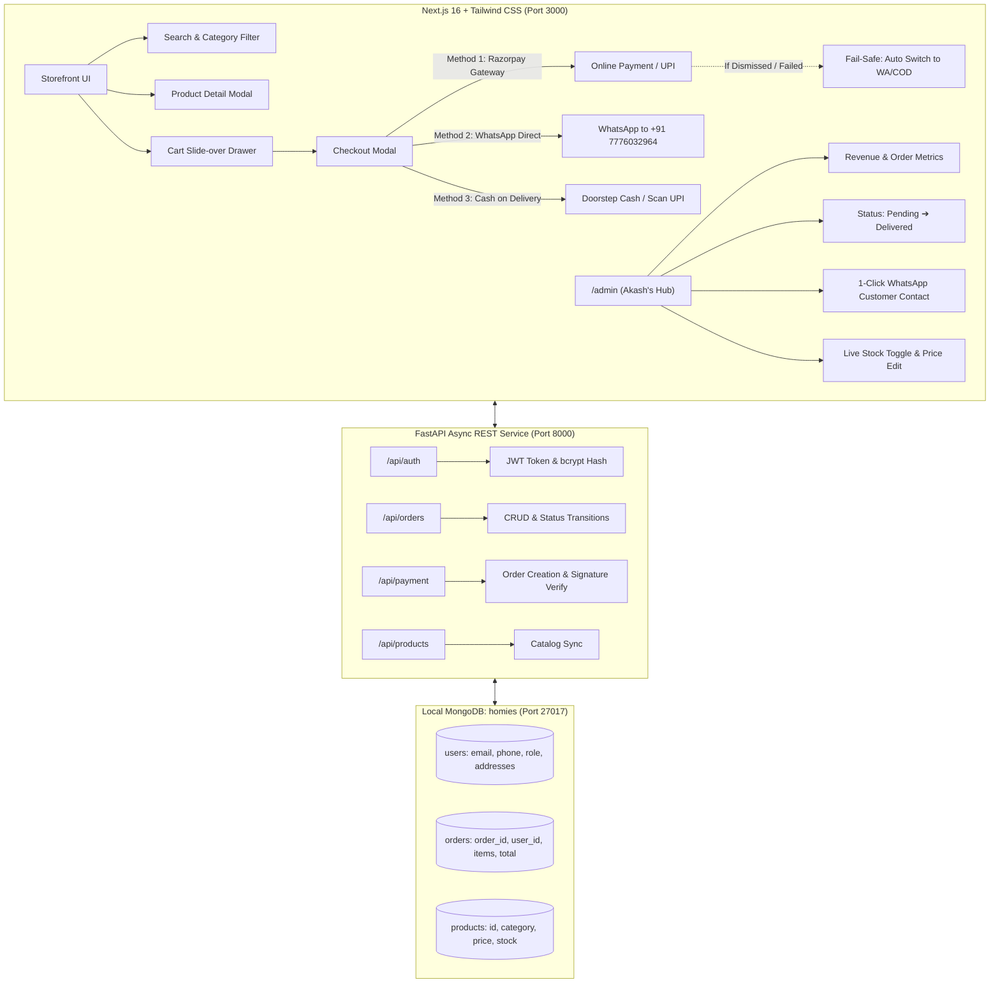

# Homies Clean - Project Context & Technical Guide

This skill file preserves the complete context, architectural patterns, and operational procedures for **Homies Clean**, a direct-to-consumer mini e-commerce product specializing in home hygiene supplies (floor cleaners, mops & wipers, toilet cleaners, and combo packs).

---

## 1. Project Identity & Key Roles

| Entity | Details |
|---|---|
| **Product / Brand** | **Homies Clean** ("Sparkling Clean Homes Made Effortless") |
| **Store Owner / Admin** | **Akash** (`akashgj777@gmail.com` / `+91 7776032964`) |
| **Test Customer Account** | `test@gmail.com` / `akash123456` |
| **Storefront URL** | `http://localhost:3000` |
| **Customer Auth Portal** | `http://localhost:3000/login` |
| **Admin Control Hub** | `http://localhost:3000/admin` (Visible only to Admin) |
| **FastAPI REST API** | `http://localhost:8000` |
| **Interactive API Docs** | `http://localhost:8000/docs` |

---

## 2. Full Architecture & Data Flow



---

## 3. What Has Been Built Up to This Point

### A. Next.js 16 Storefront (`src/`)
1. **Catalog System**:
   - 10 pre-loaded high-demand cleaning products categorized into:
     - Floor Cleaners (Citrus antibacterial, Herbal Pine insect-repellent)
     - Toilet Cleaners (Power blue gel, Grout scale remover)
     - Mops & Cleaning Tools (360° spin mop set, microfiber flat mop, rubber floor squeegees)
     - Bathroom & Kitchen (Streak-free glass & multi-surface sparkle spray)
     - Value Combos (Household starter kit, Bathroom duo pack)
   - Stored in [src/data/products.ts](file:///Users/provakil/Homies/src/data/products.ts).
2. **Interactive UI & Cart Drawer**:
   - Sticky header with search, cart badge, WhatsApp helpline, and role-based Admin link.
   - Category filter pills, sorting by price/rating, and keyword search.
   - **Skeleton Loading State**: Animated placeholder skeleton pulses while loading basket data to prevent content flash.
   - **In-Basket Login Gate**: If a customer clicks "Proceed to Order" without an account, a clean in-drawer login gate offers 1-click test login (`test@gmail.com`) or guest checkout. Upon sign in, the basket is immediately visible and transitions into checkout with auto-synced address details.
   - Persistent shopping cart (`localStorage`) with free delivery progress bar (threshold: ₹499).
   - Multi-image product detail modal with usage instructions and key benefits.
3. **Razorpay Standard 4-Step Checkout & Fail-Safe Fallback**:
   - **Step 1 (Keys)**: Configured via `RAZORPAY_KEY_ID` & `RAZORPAY_KEY_SECRET`.
   - **Step 2 (Order Creation)**: Server calls Razorpay Orders API (`/api/payment/razorpay/create-order`) with amount in paise and returns `razorpay_order_id`.
   - **Step 3 (Standard Checkout)**: Client launches official checkout modal with `order_id` supporting UPI (GPay/PhonePe), Cards, and NetBanking.
   - **Step 4 (Signature Verification & Webhook)**: Server validates HMAC SHA256 (`/api/payment/razorpay/verify`) and catches async events via `/api/payment/razorpay/webhook`.
   - **Fail-Safe Fallback**: If Razorpay modal is dismissed or payment fails, customers get an instant 1-click fallback to **WhatsApp Order (+91 7776032964)** or **Cash on Delivery** without losing entered addresses.
   - **Cash on Delivery**: Generates unique tracking order ID (`HMY-XXXXXX`).

### B. Admin Hub (`src/app/admin/page.tsx`)
- Protected login gate for Akash (`akashgj777@gmail.com` with PIN `7776032964`).
- KPI metric dashboard: Gross sales, pending packing, out-for-delivery, and completed.
- Order management with real-time status transitions:
  `Pending` ➔ `Confirmed` ➔ `Processing` ➔ `Shipped` ➔ `Delivered` ➔ `Cancelled`.
- **1-Click WhatsApp Customer Contact**: Generates instant message to customer with order tracking.
- Inventory toggle to mark products In Stock / Out of Stock on the live storefront.
- **In-Admin Image & Product Uploader**: Uploads images directly into `/public/products/` via `/api/upload` and creates new products on the live catalog.
- **Printable Tax Invoices & Delivery Slips**: Embedded `InvoiceModal` with GSTIN formatting, order items, and 1-click browser Print / PDF save.
- **Low-Stock Alert Tab**: Monitors items where `stockCount <= 5` with 1-click restocking.
- **Automated WhatsApp Status Dispatch**: On marking orders as `Shipped` or `Delivered`, prompts admin to send live tracking updates to the customer.

### C. Advanced E-Commerce Capabilities
1. **Coupons / Promo Code Engine**:
   - `HOMIES50` (Flat ₹50 off > ₹499)
   - `CLEAN20` (20% off > ₹799)
   - `FIRST10` (10% off > ₹299)
   - Interactive in-basket code validator with suggestion chips.
2. **Pincode Delivery Estimator**:
   - 6-digit Indian PIN code checker identifying Express Metro Zones (24-48 hr) vs Standard Delivery.
3. **Verified Buyer Reviews**:
   - Customer feedback list and interactive review submission with star ratings.
4. **Visual Order Tracking Timeline (`/track`)**:
   - 5-stage milestone tracker (`Placed` ➔ `Confirmed` ➔ `Packing` ➔ `Dispatched` ➔ `Delivered`).
5. **Subscribe & Save Refills (15% OFF)**:
   - Monthly refill subscription option with automated 15% discount calculation.

### D. FastAPI Backend (`backend/`)
- Fully modular Python service in [backend/](file:///Users/provakil/Homies/backend/).
- **Auth**: `/api/auth/signup`, `/api/auth/login`, `/api/auth/me` with bcrypt and JWT.
- **Orders**: `/api/orders` (CRUD, status updates, customer phone search).
- **Payment**: `/api/payment/razorpay/create-order` & `/api/payment/razorpay/verify`.
- **Products**: `/api/products` (Catalog list, add, update).
- **MongoDB Atlas Integration**: Using `motor` with async connection management and resilient fallback for local offline testing.
- Includes Python virtual environment (`backend/venv`), [backend/requirements.txt](file:///Users/provakil/Homies/backend/requirements.txt), [backend/.gitignore](file:///Users/provakil/Homies/backend/.gitignore), and environment templates.

---

## 4. File Structure Map

```
Homies/
├── .agents/
│   └── skills/
│       └── homies-clean/
│           └── SKILL.md             <-- THIS CONTEXT RUNBOOK
├── backend/
│   ├── app/
│   │   ├── core/
│   │   │   ├── config.py            <-- App settings, admin credentials, env loader
│   │   │   └── security.py          <-- bcrypt hashing & JWT token encoder
│   │   ├── db/
│   │   │   └── mongodb.py           <-- Motor async MongoDB Atlas client & fallback
│   │   ├── models/
│   │   │   ├── user.py              <-- User signup, login & response schemas
│   │   │   ├── product.py           <-- Product catalog schemas
│   │   │   └── order.py             <-- Order and Razorpay schemas
│   │   ├── routes/
│   │   │   ├── auth.py              <-- Auth endpoints
│   │   │   ├── orders.py            <-- Order management endpoints
│   │   │   ├── products.py          <-- Product catalog endpoints
│   │   │   └── payment.py           <-- Razorpay order & signature endpoints
│   │   └── main.py                  <-- FastAPI app entrypoint with CORS
│   ├── .env                         <-- Local secrets (ignored by git)
│   ├── .env.example                 <-- Template for MongoDB Atlas & Razorpay keys
│   ├── .gitignore                   <-- Ignores venv/, .env, __pycache__, logs
│   ├── requirements.txt             <-- Python package dependencies
│   └── README.md                    <-- Backend instructions
├── public/
│   └── products/
│       └── README.md                <-- Guide for dropping real product photos
├── src/
│   ├── app/
│   │   ├── admin/
│   │   │   └── page.tsx             <-- Akash's Admin Control Center
│   │   ├── globals.css              <-- Tailwind CSS v4 styling
│   │   ├── layout.tsx               <-- Root layout with ClientProviders
│   │   └── page.tsx                 <-- Main Storefront page
│   ├── components/
│   │   ├── CartDrawer.tsx           <-- Shopping cart slide-over
│   │   ├── CategoryFilter.tsx       <-- Filter pills and sorting
│   │   ├── CheckoutModal.tsx        <-- Multi-mode checkout with Razorpay & fallback
│   │   ├── ClientProviders.tsx      <-- CartProvider & modals wrapper
│   │   ├── Footer.tsx               <-- Brand footer with trust badges
│   │   ├── Header.tsx               <-- Navigation bar with search & Admin link
│   │   ├── HeroBanner.tsx           <-- Hero promotional banner
│   │   ├── OrderSuccessModal.tsx    <-- Confirmation modal
│   │   ├── OrdersHistoryModal.tsx   <-- Customer previous orders drawer
│   │   ├── ProductCard.tsx          <-- Product card with quick add
│   │   └── ProductDetailModal.tsx   <-- Full details & directions for use
│   ├── context/
│   │   └── CartContext.tsx          <-- Global cart, products & orders state
│   ├── data/
│   │   └── products.ts              <-- Store settings & initial cleaning products
│   ├── types/
│   │   └── product.ts               <-- TypeScript interfaces for store entities
│   └── utils/
│       └── razorpay.ts              <-- Razorpay checkout script & fallback handler
├── package.json
└── tsconfig.json
```

---

## 5. Operations & Developer Runbook

### Running the Servers:
```bash
# 1. Start Next.js Storefront (Port 3000)
npm run dev

# 2. Build for Production Verification
npm run build

# 3. Start FastAPI Backend (Port 8000)
PYTHONPATH=. backend/venv/bin/uvicorn backend.app.main:app --host 0.0.0.0 --port 8000 --reload
```

### Adding Real Product Photos:
1. Place photo files into `public/products/` (e.g., `floor-cleaner.jpg`, `spin-mop.jpg`).
2. Update the `image` path in `src/data/products.ts` to `/products/floor-cleaner.jpg`.

### Connecting MongoDB Atlas:
1. Obtain connection string from [MongoDB Atlas](https://cloud.mongodb.com).
2. Set `MONGODB_URL` in `backend/.env`.
3. Restart FastAPI backend. Collections `users`, `products`, and `orders` will be auto-managed.
