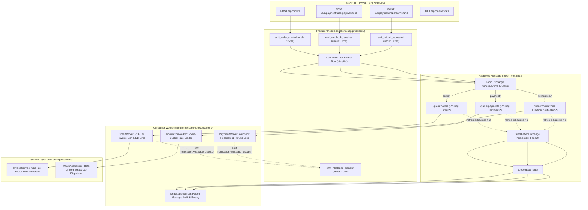

# Homies Clean - Master Project Documentation

**Homies Clean** is a direct-to-consumer mini e-commerce web application engineered specifically for household cleaning supplies (floor cleaners, mops & squeegees, toilet cleaners, and value bundles).

---

## 📌 Executive Summary

- **Store Owner & Administrator**: **Akash** (`akashgj777@gmail.com` | `+91 7776032964`)
- **Test Customer User**: `test@gmail.com` | Password: `akash123456`
- **Storefront**: [http://localhost:3000](http://localhost:3000)
- **Customer Auth Portal**: [http://localhost:3000/login](http://localhost:3000/login)
- **Admin Control Center**: [http://localhost:3000/admin](http://localhost:3000/admin) *(PIN: `7776032964`)*
- **FastAPI REST API**: [http://localhost:8000](http://localhost:8000)
- **Interactive API Documentation**: [http://localhost:8000/docs](http://localhost:8000/docs)
- **Agent Context Skill**: [.agents/skills/homies-clean/SKILL.md](.agents/skills/homies-clean/SKILL.md)

---

## 🏗️ Architecture & Tech Stack

### 1. Frontend: Next.js 16 + Tailwind CSS v4
- **Framework**: Next.js 16 (App Router) with TypeScript.
- **Styling**: Tailwind CSS v4 with clean, modern hygiene palette (sky blues, emerald greens, crisp neutrals).
- **Icons**: `lucide-react`.
- **State Management**: `CartContext` & `AuthContext` with `localStorage` persistence and **Skeleton Loaders** (preventing layout shift / empty flash).
- **In-Basket Login Gate**: If a customer adds items to their basket while logged out, clicking "Proceed to Order" prompts them to sign in (with 1-click test customer `test@gmail.com`). Once authenticated, the basket items remain 100% intact and visible, transitioning smoothly into checkout with their delivery address auto-filled!
- **Admin Portal**: Integrated at `/admin` (hidden from regular customers) with KPI metrics, status updates, stock management, and 1-click WhatsApp customer contact.

### 2. Backend: FastAPI (Python 3.9+)
- **Location**: `backend/` folder in project root.
- **Asynchronous Engine**: FastAPI + Uvicorn.
- **Database**: Local MongoDB `homies` (`mongodb://127.0.0.1:27017`) via `motor` async driver.
- **Authentication**: JWT token management + bcrypt password hashing for signup and login.
- **Payment Routes**: Server-side Razorpay order generation and cryptographic HMAC signature verification.

---

## 🗄️ MongoDB Database Architecture (`homies`)

### Collection Schemas & Relationship Design:

```
[users Collection]
├── id (String, UUID e.g. "user-customer-demo") <--------+
├── email (String, UNIQUE INDEX)                         |
├── phone (String, INDEX)                                | (Linked Relationship)
├── full_name (String)                                   |
├── role ("admin" | "customer")                          |
├── addresses (Array of { street, city, pincode })       |
└── created_at (Timestamp)                               |
                                                         |
[orders Collection]                                      |
├── id (String, UUID)                                    |
├── order_id (String, UNIQUE INDEX e.g. "HMY-261121-DEMO1")
├── user_id (String, INDEX) -----------------------------+
├── customer_name (String)
├── phone (String, INDEX)
├── address, city, pincode (Strings)
├── items (Array of { product_id, name, unit, price, quantity })
├── subtotal, delivery_charge, discount, total (Floats)
├── payment_method ("RAZORPAY" | "WHATSAPP" | "COD")
├── payment_status ("PAID" | "PENDING" | "FAILED")
├── status ("Pending" | "Confirmed" | "Processing" | "Shipped" | "Delivered")
├── razorpay_order_id, razorpay_payment_id (Strings)
└── created_at (Timestamp, INDEX)

[products Collection]
├── id (String, UNIQUE INDEX e.g. "prod-1")
├── name, category, category_label (Strings)
├── price, original_price (Floats)
├── in_stock (Boolean, live toggle)
├── image, additional_images (Strings)
└── benefits, usage_instructions (Arrays/Strings)
```

### Provisioning & Seeding:
Run the built-in database setup script anytime to verify indexes and seed core products & admin:
```bash
PYTHONPATH=. backend/venv/bin/python3 backend/app/db/init_db.py
```

---

## 💳 Payment & Ordering Architecture

```
                                      [Customer in Checkout]
                                                 |
                   +-----------------------------+-----------------------------+
                   |                                                           |
          [Option 1: Razorpay]                                      [Option 2: WhatsApp / COD]
                   |                                                           |
        (UPI / Card / NetBanking)                                (Direct to +91 7776032964)
                   |
        +----------+----------+
        |                     |
    [Success]             [Failed / Dismissed]
        |                     |
 [Order Confirmed]     [Fail-Safe Fallback Prompt]
                              |
                    (Auto 1-Click Switch to
                     WhatsApp Order or COD)
```

### Core 4-Step Integration Flow

1. **Get API Keys (Step 1)**:
   - Configure `RAZORPAY_KEY_ID` and `RAZORPAY_KEY_SECRET` in `backend/.env` or `.env.local` (starts in test mode `rzp_test_...`).
2. **Create an Order on Server (Step 2)**:
   - Server endpoint (`/api/payment/razorpay/create-order`) calls the Razorpay Orders API with amount in currency subunits (paise) and returns the generated `razorpay_order_id`.
3. **Open Standard Checkout (Step 3)**:
   - Client passes the server-generated `order_id` and public `key_id` into `Razorpay(options)` and launches the standard checkout modal.
4. **Server Verification & Webhook Handling (Step 4)**:
   - Verification endpoint (`/api/payment/razorpay/verify`) validates the signature via HMAC SHA256 (`order_id|payment_id`).
   - Webhook listener (`/api/payment/razorpay/webhook`) reliably processes `payment.captured` and `payment.failed` asynchronous events.
5. **Fail-Safe Fallback**:
   - If a customer cancels the Razorpay modal or payment fails, the checkout instantly prompts a 1-click fallback to **WhatsApp Order (+91 7776032964)** or **Cash on Delivery** without losing form data or cart items.
3. **WhatsApp Instant Order**: Sends the entire cart itemization and customer address directly to **Akash (+91 7776032964)**.
4. **Cash on Delivery (COD)**: Doorstep cash/UPI collection with tracking order ID.

---

## ⚡ High-Throughput RabbitMQ Event Pipeline

To eliminate bottlenecks in the synchronous web request cycle, Homies Clean implements a dedicated, non-blocking asynchronous event pipeline using **RabbitMQ** (`aio-pika`), **ReportLab**, and background consumer workers.

### 1. Problem Solved
Previously, heavy tasks ran synchronously during HTTP requests:
- **Razorpay Webhooks**: Ingesting `payment.captured` / `order.paid` while verifying HMAC signatures and updating databases risked webhook timeouts.
- **Tax Invoices**: Dynamically rendering 6-section PDF documents with ReportLab blocked checkout threads.
- **WhatsApp Messaging**: Unbounded dispatches could trigger WhatsApp Business API rate limit bans.
- **Refund Reconciliation**: Communicating with payment gateway refund endpoints blocked API callers.

With this architecture:
- All web requests emit lightweight persistent AMQP events in **0.93ms – 2.3ms** (well under the 5ms SLA).
- Webhooks immediately return `HTTP 200 OK` (`{"status": "queued"}`) in **~1.5ms**.
- PDF tax invoices, database state reconciliations, and rate-limited WhatsApp notifications execute reliably in independent worker processes.

### 2. Architecture & Working Data Flow Diagram



### 3. Core Components

| Module | Location | Purpose | SLA / Performance |
|---|---|---|---|
| **Event Producer** | `backend/app/producers/rabbitmq.py` | Connection & channel pool managing non-blocking event publishing. Graceful in-memory fallback if broker is offline. | **0.9ms - 2.3ms** latency |
| **Event Emitters** | `backend/app/producers/events.py` | Typed helper functions: `emit_order_created`, `emit_webhook_received`, `emit_refund_requested`, `emit_whatsapp_dispatch`. | Lightweight JSON envelope |
| **Order Worker** | `backend/app/consumers/order_worker.py` | Generates GST-compliant PDF Tax Invoices via ReportLab, stores invoice URL in database, and emits WhatsApp confirmation. | Asynchronous background execution |
| **Payment Worker** | `backend/app/consumers/payment_worker.py` | Idempotent reconciliation of Razorpay webhooks (`payment.captured`, `order.paid`, `payment.failed`) and instant refunds. | Decoupled from payment gateway delays |
| **Notification Worker** | `backend/app/consumers/notification_worker.py` | Token-bucket rate-limited WhatsApp notifications for order confirmation, dispatch tracking, and refunds. | Strict 10 msg/sec rate-limit compliance |
| **Dead Letter Worker** | `backend/app/consumers/dlq_worker.py` | Consumes from `queue:dead_letter` when retries exceed 3 attempts with exponential backoff. Logs structured audit trails. | Zero message loss |
| **Invoice Service** | `backend/app/services/invoice_service.py` | ReportLab PDF engine: GSTIN `27AABCH1234F1Z5`, SAC/HSN codes, itemized pricing, CGST/SGST tax split, and downloadable links. | Stored at `/public/invoices/` |
| **Worker CLI Runner** | `backend/app/consumers/runner.py` | Unified runner supporting all workers or sharded single queues with graceful SIGINT/SIGTERM shutdown. | CLI `--workers all` |
| **Queue Monitoring API** | `backend/app/routes/queue.py` | Live queue depths, consumer metrics, and DLQ message replay: `/api/queue/stats` & `/api/queue/dead-letter/retry`. | Real-time observability |

---

---

## 🚀 Extended Feature Suite

### 1. Promo Code / Coupon Engine
- **Active Coupons**:
  - `HOMIES50`: Flat ₹50 off on orders over ₹499
  - `CLEAN20`: 20% discount on orders over ₹799
  - `FIRST10`: 10% discount on orders over ₹299
- Integrated into Cart Drawer with quick-apply chips and live price calculation.

### 2. Pincode Delivery Estimator
- Check serviceability and delivery timeline by 6-digit Indian PIN code.
- Auto-detects Metro express zones (Mumbai, Delhi, Bengaluru, Hyderabad, Chennai, Pune) for 24-48 hr fast dispatch.
- Saves customer PIN in localStorage to remember preferred shipping zones.

### 3. Customer Reviews & Star Ratings
- Verified buyer review list with 5-star breakdown.
- Interactive "Write a Review" submission form directly on product detail modal.
- Dynamically recalculates average rating and review counts.

### 4. Live Visual Order Tracking Timeline (`/track`)
- Track by Homies Order ID (e.g. `HMY-261121-DEMO1`).
- Visual 5-stage milestone stepper:
  1. `Order Placed`
  2. `Confirmed`
  3. `Packing`
  4. `Out for Delivery`
  5. `Delivered`
- Includes 1-click WhatsApp inquiry button linked directly to Akash (`+91 7776032964`).

### 5. In-Admin Image & Product Uploader (`/api/upload`)
- Upload photos directly into `public/products/` via multipart FormData.
- Instant preview and live product publication directly from Admin Hub without manual code changes.

### 6. Printable Tax Invoices & Delivery Slips
- Print-ready tax invoice with GSTIN (`27AABCH1234F1Z8`), invoice numbers, line items, and delivery address.
- 1-click browser Print / "Save as PDF" trigger.

### 7. Low-Stock Urgency Badges & Admin Monitor
- Red urgency badge appears automatically when `stockCount <= 5` ("🔥 Only X left!").
- Admin Hub includes a dedicated "Low Stock Alerts" monitor with 1-click +20 unit restock buttons.

### 8. "Subscribe & Save" 15% Monthly Refill Options
- Customers can toggle between "One-Time Purchase" and "Subscribe & Save 15%" for recurring cleaning supplies.
- Subscriptions are itemized in cart, order confirmation, and tax invoices.

### 9. Automated WhatsApp Status Dispatch
- When Admin updates an order to `Shipped` or `Delivered`, the system prompts 1-click WhatsApp notification dispatch to the customer with live tracking link.

---

## 🛠️ Operations & Setup Runbook

### Running the Frontend
```bash
# Development mode (Hot-reload at http://localhost:3000)
npm run dev

# Production build test
npm run build
```

### Running the FastAPI Backend
```bash
# Activate virtual environment
source backend/venv/bin/activate

# Start server with auto-reload (Runs at http://localhost:8000)
PYTHONPATH=. backend/venv/bin/uvicorn backend.app.main:app --host 0.0.0.0 --port 8000 --reload
```

### Running RabbitMQ & Background Consumer Workers
```bash
# 1. Start RabbitMQ broker (if not already running)
/opt/homebrew/opt/rabbitmq/sbin/rabbitmq-server -detached

# 2. Start all consumer workers concurrently
PYTHONPATH=. backend/venv/bin/python -m backend.app.consumers.runner --workers all

# 3. Or run sharded workers individually:
PYTHONPATH=. backend/venv/bin/python -m backend.app.consumers.runner --workers orders
PYTHONPATH=. backend/venv/bin/python -m backend.app.consumers.runner --workers payments
PYTHONPATH=. backend/venv/bin/python -m backend.app.consumers.runner --workers notifications
PYTHONPATH=. backend/venv/bin/python -m backend.app.consumers.runner --workers dlq
```


### Adding Your Real Product Images
1. Copy your product photos into `public/products/` (e.g. `floor-cleaner.jpg`, `spin-mop.jpg`).
2. Update the `image` field in `src/data/products.ts` with the new filename (e.g. `image: '/products/floor-cleaner.jpg'`).

### Connecting to MongoDB Atlas
1. Copy `backend/.env.example` to `backend/.env`.
2. Add your Atlas URI:
   ```env
   MONGODB_URL="mongodb+srv://<username>:<password>@cluster0.mongodb.net/homies_store?retryWrites=true&w=majority"
   MONGODB_DB_NAME="homies_store"
   ```
3. Restart the backend to automatically persist users, products, and orders.
