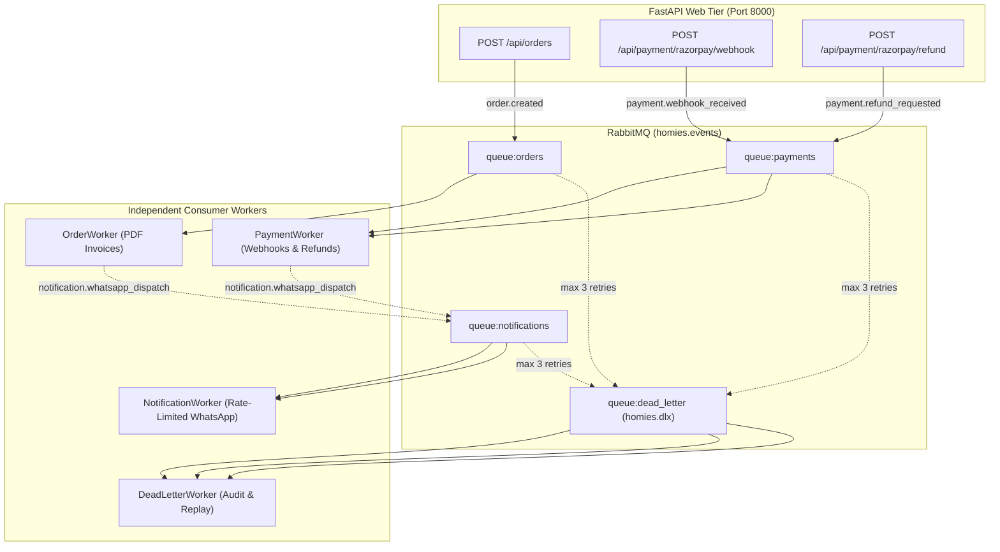

# Homies Clean - Direct-to-Consumer Home Hygiene Store

**Homies Clean** is a modern e-commerce web platform for household cleaning supplies (floor cleaners, mops & squeegees, toilet cleaners, and value combos), featuring WhatsApp ordering, Razorpay online payments, local MongoDB Atlas data persistence, and an interactive Admin Control Center.

---

## 🚀 Quick Start

### 1. Frontend (Next.js 16 + Tailwind CSS)
```bash
# Install dependencies
npm install

# Start development server
npm run dev
```
Open [http://localhost:3000](http://localhost:3000) to view the storefront.

### 2. Backend (FastAPI + MongoDB)
```bash
# Activate virtual environment
source backend/venv/bin/activate

# Start FastAPI server
PYTHONPATH=. uvicorn backend.app.main:app --host 0.0.0.0 --port 8000 --reload
```
Interactive API documentation is available at [http://localhost:8000/docs](http://localhost:8000/docs).

### 3. RabbitMQ Message Broker & Consumers
```bash
# Start all background workers
PYTHONPATH=. backend/venv/bin/python -m backend.app.consumers.runner --workers all
```
Live queue statistics available at [http://localhost:8000/api/queue/stats](http://localhost:8000/api/queue/stats).

---

## 🔑 Key Roles & Credentials

- **Store Owner & Admin**: **Akash** (`akashgj777@gmail.com` / `+91 7776032964`)
- **Admin Hub**: [http://localhost:3000/admin](http://localhost:3000/admin) *(PIN: `7776032964`)*
- **Test Customer**: `test@gmail.com` / `akash123456`
- **Order Tracker**: [http://localhost:3000/track](http://localhost:3000/track)

---

## ⚡ Asynchronous Event Pipeline (RabbitMQ)

Homies Clean uses an asynchronous event-driven pipeline via RabbitMQ (`aio-pika`) ensuring sub-2ms response times for all critical user workflows:



---

## 📦 Features

- **High-Throughput RabbitMQ Pipeline**: Decoupled order event emissions (< 1.5ms), non-blocking webhook ingestion (< 1.0ms), and automated dead-letter handling.
- **Automated Tax Invoices**: GST-compliant PDF Tax Invoices generated via ReportLab and stored at `/public/invoices/`.
- **Rate-Limited WhatsApp Notifications**: Token-bucket algorithm strictly enforcing delivery rates.
- **Standard Checkout & WhatsApp Order**: Razorpay online gateway with instant 1-click fallback to WhatsApp (+91 7776032964) or Cash on Delivery.
- **In-Basket Login Gate**: Shimmering skeleton loaders prevent layout shift; shoppers can log in with 1 click without losing basket contents, auto-filling delivery addresses.
- **Promo Code Engine**: `HOMIES50`, `CLEAN20`, `FIRST10` coupon codes with live basket discounts.
- **Pincode Delivery Estimator**: 6-digit Indian PIN checker identifying Express Metro delivery zones.
- **Verified Reviews & Ratings**: Verified buyer feedback with live review submission form.
- **Printable Tax Invoices**: GST tax invoice generator with 1-click PDF print.
- **Live Visual Order Tracking**: 5-stage milestone tracking timeline.
- **In-Admin Image & Product Uploader**: Direct upload to `/public/products/` and instant live product publishing.
- **Low-Stock Urgency Badges**: Urgency warnings on storefront when inventory $\le 5$ with an admin restock monitor.
- **Subscribe & Save**: 15% discount on recurring monthly cleaning supply refills.

---

## 📖 Complete Documentation

See [DOCUMENTATION.md](DOCUMENTATION.md) for full architectural diagrams, MongoDB schemas, and operational runbooks.
